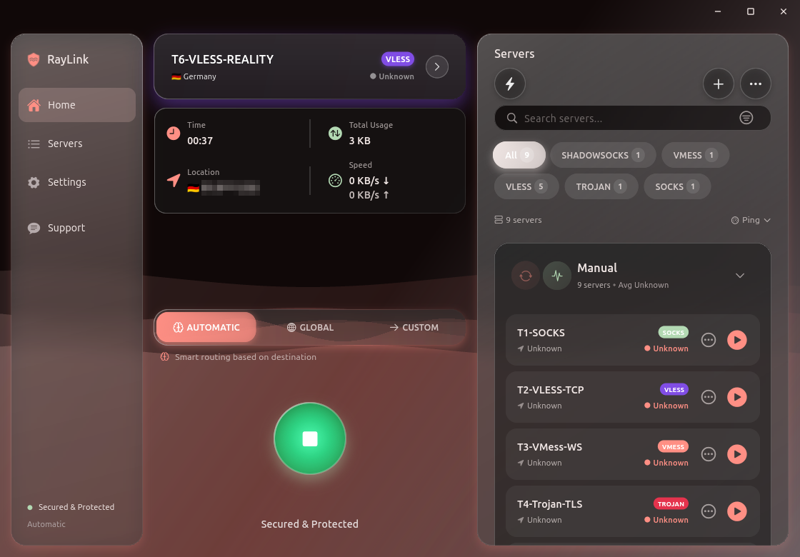
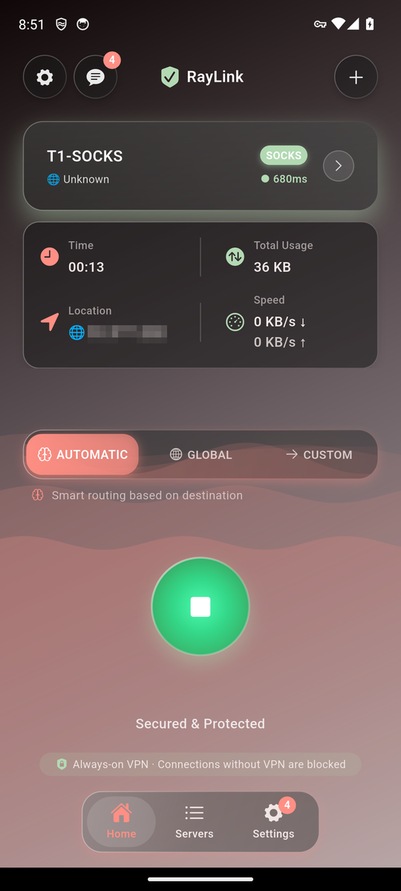

<div align="center">


# RayLink

**Fast, private connections on every device.**

**English** · [فارسی](README.fa.md)

<br>

[](#windows)
[](#macos)
[](#android)
[](#linux)

<br>

&nbsp;&nbsp;

<br>
<br>

[](https://github.com/LumenDreams/RayLink-Build/releases/latest)

</div>

<br>

- **One tap to connect.** Add servers from a link, a QR code or a subscription: VLESS (REALITY too), VMess, Trojan, Shadowsocks and SOCKS.
- **Your whole device, protected.** Send everything through RayLink, or only the apps that use the system proxy.
- **Kill switch.** Blocks your traffic if the connection drops.
- **Smart routing.** Automatic, Global, or your own rules.
- **Your language.** 11 languages, among them Persian (فارسی) and Arabic (العربية).
- **Help when you need it.** Chat with support right inside the app.

## Downloads

**RayLink 1.0.1** (build 47) · every file with its checksum is on the [release page](https://github.com/LumenDreams/RayLink-Build/releases/latest)

| Platform | Your device | Download | Size |
| :-- | :-- | :-- | --: |
| **Windows** 10 or 11 | Most PCs (Intel or AMD) | [Installer](https://github.com/LumenDreams/RayLink-Build/releases/download/v1.0.1/RayLink-1.0.1-47-windows-x64-setup.exe) | 23.8 MB |
| | ARM PCs (Snapdragon) | [Installer for ARM](https://github.com/LumenDreams/RayLink-Build/releases/download/v1.0.1/RayLink-1.0.1-47-windows-arm64-setup.exe) | 22.0 MB |
| **macOS** 12 or later | Apple silicon and Intel Macs | [DMG](https://github.com/LumenDreams/RayLink-Build/releases/download/v1.0.1/RayLink-1.0.1-47-macos.dmg) | 58.7 MB |
| **Android** 7.0 or later | Phones and tablets | [APK](https://github.com/LumenDreams/RayLink-Build/releases/download/v1.0.1/RayLink-1.0.1-47-android.apk) | 52.3 MB |
| **Linux** | Ubuntu 22.04+, Debian 12+, Linux Mint 21+ | [.deb](https://github.com/LumenDreams/RayLink-Build/releases/download/v1.0.1/raylink_1.0.1-47_amd64.deb) | 20.4 MB |
| | Fedora, RHEL 9 and compatible | [.rpm](https://github.com/LumenDreams/RayLink-Build/releases/download/v1.0.1/raylink-1.0.1-47.x86_64.rpm) | 29.6 MB |
| | Other distributions | [AppImage](https://github.com/LumenDreams/RayLink-Build/releases/download/v1.0.1/RayLink-1.0.1-47-x86_64.AppImage) | 26.9 MB |
| **Linux on ARM** | Ubuntu 22.04+, Debian 12+, Raspberry Pi OS (64-bit) | [.deb](https://github.com/LumenDreams/RayLink-Build/releases/download/v1.0.1/raylink_1.0.1-47_arm64.deb) | 18.3 MB |
| | Fedora, RHEL 9 and compatible | [.rpm](https://github.com/LumenDreams/RayLink-Build/releases/download/v1.0.1/raylink-1.0.1-47.aarch64.rpm) | 28.1 MB |
| | Other distributions | [AppImage](https://github.com/LumenDreams/RayLink-Build/releases/download/v1.0.1/RayLink-1.0.1-47-aarch64.AppImage) | 25.4 MB |

## Install

### Windows

1. Open the installer: **Installer for ARM** on ARM PCs (such as Snapdragon laptops), **Installer** on all others.
2. If Windows SmartScreen appears, select **More info**, then **Run anyway**.
3. Approve the administrator prompt. RayLink installs a small service that runs the connection.

To update, install the new version over the old one; your servers and settings are kept. To remove RayLink, uninstall it from **Settings → Apps**.

### macOS

1. Open the DMG and drag **RayLink** into **Applications**.
2. Open RayLink. The first time, it asks for your password to install the service that runs the connection.
3. To scan a QR code on your screen, allow RayLink under **System Settings → Privacy & Security → Screen Recording** when asked.

The first time, macOS may stop RayLink from opening. Open **System Settings → Privacy & Security** and select **Open Anyway**.

### Android

1. Open the APK on your phone.
2. If Android asks, allow your browser or file manager to install apps, then tap **Install**.
3. The first time you connect, allow RayLink to set up a VPN connection.

New versions install over the old one and keep your servers.

### Linux

**Ubuntu, Debian, Linux Mint**

```bash
sudo apt install ./raylink_1.0.1-47_amd64.deb
```

**Fedora, RHEL**

```bash
sudo dnf install ./raylink-1.0.1-47.x86_64.rpm
```

**Other distributions**

```bash
chmod +x RayLink-1.0.1-47-x86_64.AppImage
./RayLink-1.0.1-47-x86_64.AppImage
```

The first time it starts, the AppImage asks for your password to install the service that runs the connection.

On an ARM computer, such as a Raspberry Pi, use the ARM files with the same commands: `raylink_1.0.1-47_arm64.deb`, `raylink-1.0.1-47.aarch64.rpm` or `RayLink-1.0.1-47-aarch64.AppImage`.

On GNOME, RayLink's tray icon needs the *AppIndicator and KStatusNotifierItem Support* extension, which Ubuntu includes.

To remove RayLink, run `sudo apt remove raylink` or `sudo dnf remove raylink`.

<details>
<summary><b>Verify a download</b></summary>

<br>

Compare the SHA-256 checksum of your file with `SHA256SUMS.txt` on the [release page](https://github.com/LumenDreams/RayLink-Build/releases/latest).

```bash
sha256sum raylink_1.0.1-47_amd64.deb                        # Linux
shasum -a 256 RayLink-1.0.1-47-macos.dmg                    # macOS
```

```powershell
Get-FileHash .\RayLink-1.0.1-47-windows-x64-setup.exe       # Windows
```

Every Android release is signed with the same certificate:

```
8F:68:66:76:09:78:78:A5:3D:26:CC:FC:F1:94:C6:12:50:39:E0:1E:C9:9D:77:CA:73:25:D1:58:18:60:DD:B1
```

</details>

## Support

Open **Support** in the app to chat with us, or write to [support@raylink.app](mailto:support@raylink.app).

<br>

<div align="center"><sub>© 2026 LumenDreams</sub></div>
